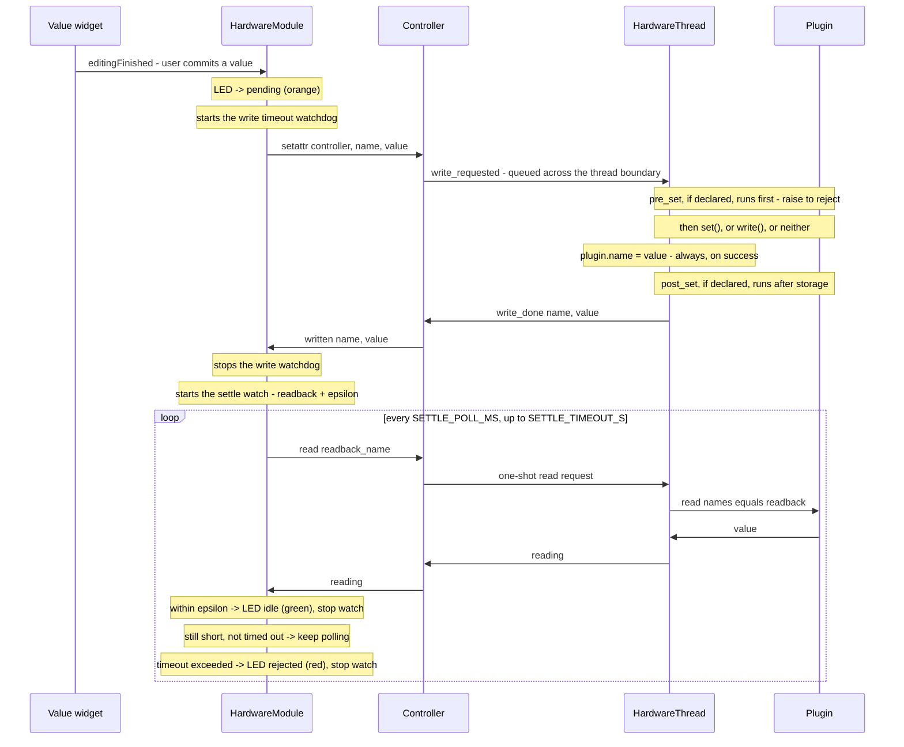
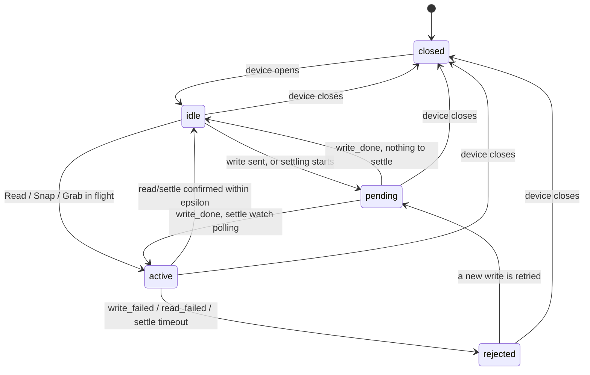

# HardwareModule: the GUI

**Scope of this file:** `hardware_module.py` and `representations.py` - the GUI layer, a
`QMainWindow` built entirely from a device's declared `Capabilities`, talking to the device only
through `Controller` - never calling the plugin directly, never touching the hardware thread. See
`control_modules/hardware/README.md` for that layer (declarations, the device thread, the
registry, `Controller` itself).

## 1. Layout

```
[ Ini. | status | Settings ]                       <- instrument toolbar (top)
+----------------+------------------------------+
| Channels (dock)|  view docks (right)          |
| spectrum  [Snap] [Grab] [Show Graph]          |  <- one toolbar per quantity
| temperature [Read] [Show Graph]               |
| status    [Read]                              |
| exposure  [spinbox]                           |
| trigger   [selector]                          |
+----------------+------------------------------+
```

- **Instrument toolbar** (top): the device's name, **Ini.** (checkable - cable icon, red when
  closed, green when open; uncheck to close), **Settings** (opens/closes the plugin settings
  dock), and the status text, right-aligned.
- **Channel dock** (left): one `QToolBar` per quantity - name, a display (for a measurement or a
  control's own readback), a value widget (spinbox/selector/toggle, picked by `representations.py`
  from the quantity's access/domain), any declared actions, and **Show Graph** if it has one.
  Built once, from the **class-level** declared `Capabilities` (`_build_channels`, in
  `__init__`) - before the device is even opened, and disabled (`channels_dock.setEnabled(False)`)
  until it actually connects, so a click can never silently reach a hardware thread that's not
  running yet.
- **Views** (right): one dock per quantity with **Show Graph** open, picked by shape -
  `Viewer0D`/`Viewer1D`/`Viewer2D` for a scalar/1D/2D reading (`_viewer_type`, by `len(shape)`;
  anything past 2D is rejected at construction, in `_fill_channel_toolbar`, not later inside a
  paint callback). A reading that's already a real `DataWithAxes`/`DataRaw` (several labeled
  curves, a real axis) is passed straight through, unexamined - see `get=`'s own docstring in
  `capabilities.py` and the catalog example's `channels` row.
- **Polling only happens with Grab** (continuous) or Snap/Read (one-shot); **Show Graph** only
  opens or closes the view - the view shows whatever readings arrive, from any source.

## 2. Connecting

`__init__` builds every row from `controller.capabilities` - the class-level declared
`Capabilities` - synchronously, before the device has ever been opened. Pressing **Ini.** queues
`ini_hardware` onto the hardware thread (see the other README's Lifecycle section); once
`device_status(True, ...)` comes back, `_on_status`:

- Enables the channel dock.
- Re-starts Grab for any channel still in `_grabbing` (a disconnect clears pending/failed/reading
  state and stops every settle watch, but Grab itself restarts automatically on reconnect, since
  `close_hardware` releases every subscription when the device closes).
- Calls `_sync_initial_value` for every control: one with its own `get=` gets a cheap one-shot
  read whose result goes straight into the widget - unlike a plain Read, which never touches
  widget sync (only a confirmed write does, via `_on_written`). A control declaring no `get=` has
  no way to be known from here at all (nothing above the hardware thread can read the plugin
  directly), so it just keeps its construction default (a spinbox at 0, a combo box's first item)
  until its first write confirms a real value.

## 3. Writing a value, and settling

A control with both `readback=` and a non-zero `epsilon` (e.g. a motor axis) stays **pending**
(orange) after a confirmed write until its readback polls within tolerance - what replaces a
separate "move done" signal. A control with neither just resolves the moment the write itself is
confirmed.



Every write also gets its own `WRITE_TIMEOUT_S` watchdog, independent of settling: a write that
never gets `write_done`/`write_failed` within the window is marked rejected the same way a real
failure would be - this covers "nobody ever heard back at all," which the settle watch alone
never did (it only starts once `write_done` has already arrived). `stop=`, or any
`interrupts=True` action, resolves both the write watchdog and the settle watch the same way a
real `write_done` would - a control that's mid-move has nothing left to settle towards once
stopped.

## 4. The channel LED's priority cascade

Simplified: the real check (`_led_state`) is one priority cascade over a few sets (`_pending`,
`_failed`, `_reading`/`_grabbing`), not a literal state machine - drawn here as one, since the
cascade's effect *is* a state machine from the outside.



A disconnect (`_on_status(False)`) clears `_pending`/`_failed`/`_reading` outright and stops every
active settle watch - a write, settle, or one-shot read in flight when the device drops has no
watcher left to ever confirm or fail it, so the row goes back to idle rather than staying stuck.

## 5. Reading: poll, grab, one-shot

- **Grab** (`_set_grabbing(name, True)`): `controller.poll(name, grab_period_ms)` creates a
  `'latest'`-policy `Subscription`. One shared `QTimer` per distinct period serves every channel
  subscribed at it; each tick batches every channel sharing that period into one
  `plugin.read(names=..., fresh=True)` call - except a channel with its own `get=`, which is read
  individually and so opts itself out of the plugin's batching. `Controller._on_reading` caches
  the value and emits `new_reading`; `_on_reading` here updates the display label and, for a
  numeric value, the view's curve/history.
- **Read / Snap** (`_read(name)`): `controller.read(name, cb)`, a `period_ms=None` one-shot
  subscription, released once it answers.

## 6. Actions: plain, checkable, stop

1. A button click calls `controller.run_action` -> `action_requested` -> `HardwareThread
   .request_action`, which looks up the named `Action` and calls `callback(plugin, checked)` if
   `checkable` else `callback(plugin)`.
2. `action_done`/`action_failed` mirror the write done/failed shape, but an action is never
   treated as a write - no settling, and the click is no guarantee it has run yet (a queued
   cross-thread call).
3. `_on_action_done`: only when `action_name == 'stop'` does it clear the settle watch and
   pending/failed state - specific to `stop` interrupting a move, not a general consequence of any
   action succeeding. A non-`None` result (e.g. `stop` reporting the position it froze at) fans
   out to every widget showing that channel, the same as a confirmed write, but without going
   through `_on_written`.
4. `_on_action_failed` marks the row failed (red), same as a rejected write, but leaves any settle
   watch alone - nothing about an in-progress move changed because *this* action failed.

## 7. `merge_into`: a control inside another row

Resolved once, in `Capabilities.__post_init__` (the other README's own scope): the target must be
a declared quantity, a control can't merge into itself, and merges can't chain. At render time,
the merged button writes through the exact same path as a row of its own (`_write`), just drawn
inside another quantity's toolbar, with its checked state bound `FROM_SYNC` to that quantity's own
confirmed value like any other widget.

## 8. Pushed readings

A measurement declared `push=True` is delivered through `plugin.push_reading(channel, data)`,
callable from *any* thread (e.g. an SDK's own callback thread) - never given a poll timer, and
never batched with anything else. The hardware thread queues it to itself via a signal, then fans
it out exactly like a periodic reading would.

## 9. Settings: GUI edits vs. the plugin changing itself

Two paths land in the same tree, deliberately asymmetric so neither loops back into the other:

- **A GUI edit** fires `controller.settings`' own `sigTreeStateChanged` -> `_relay_settings_change`
  -> `update_settings` on the hardware thread, applied under a `QSignalBlocker` before
  `commit_settings` runs.
- **The plugin changing its own settings** (inside `commit_settings` itself, or anywhere else)
  fires the thread's own tree's real `sigTreeStateChanged` (not blocked) -> forwarded as
  `settings_changed` ('value'/'limits'/'options'/'childAdded', see the other README) ->
  `Controller._on_device_settings_changed` applies it to `controller.settings` with a re-entrancy
  flag set around the call.

This module needs no signal of its own for either direction: its Settings dock shares
`controller.settings` directly, so once `Controller` has applied a change, the dock already shows
it.

**One asymmetry, found while building the settings-sync forwarding above:** a toolbar write
correctly updates the Settings dock too (`request_write`'s own write to a plugin setting fires the
same `settings_changed` relay as any plugin-driven change). Editing the *Settings dock* directly
does not update the toolbar widget back - that edit goes through `update_settings`, which emits no
confirmation signal at all (unlike `request_write`'s `write_done`) for anything here to react to.
Not fixed - see Known gaps.

## 10. Known gaps

- The settings-dock-edit asymmetry above: `update_settings` needs its own confirmation signal
  (mirroring `write_done`), or `_relay_settings_change` needs to push the new value to
  `_sync_for(name)` optimistically the moment the edit is accepted.
- Not a `ControlModule` yet: the Dashboard, Dashboard presets, and `ModulesManager` can't load a
  `HardwareModule`.
- Missing widgets: `show_controls`, `save`. A control's `ui_add` can name them; they're skipped.
- Settings persistence is restore-only: `make_plugin_settings(plugin_class, params_state)` can
  load a previously-saved state in, but nothing anywhere calls `settings.saveState()` back out -
  no save-on-close, no file, no hook. Editing a plugin setting doesn't survive closing and
  reopening the module.
- A settings-tree action button (`'type': 'action'`, firing `sigActivated`) does nothing: unlike a
  value edit, a click never crosses the thread boundary at all - the GUI-side and thread-side
  settings trees are separate `Parameter` objects, and nothing relays `sigActivated` between them.
- Instance capabilities a plugin reports only after `open()` reach `Controller` but are only
  stored, never acted on here - no live-refresh path for a new quantity appearing, or an existing
  one's `units`/`shape`/values changing after `open()`.
- Nothing here has run against real hardware yet; `pymodaq_plugins_mock`-backed plugins only.

## See also

- `control_modules/hardware/README.md`: the layer underneath this one - declarations, the device
  thread, the registry, `Controller`.
- `examples/hardware_module_minimal_example.py`, `hardware_module_example.py` (spectrometer),
  `hardware_module_stage_example.py`, `hardware_module_catalog_example.py`, and the companion
  `examples/capabilities_read_write_catalog.md` indexing every `get=`/`set=`/`pre_set=`/
  `post_set=`/`readback=` combination to the example row that demonstrates it.
