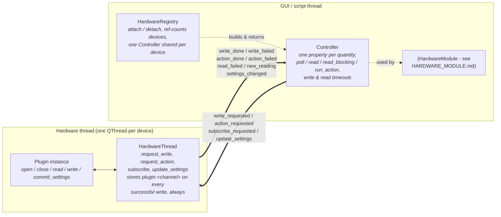
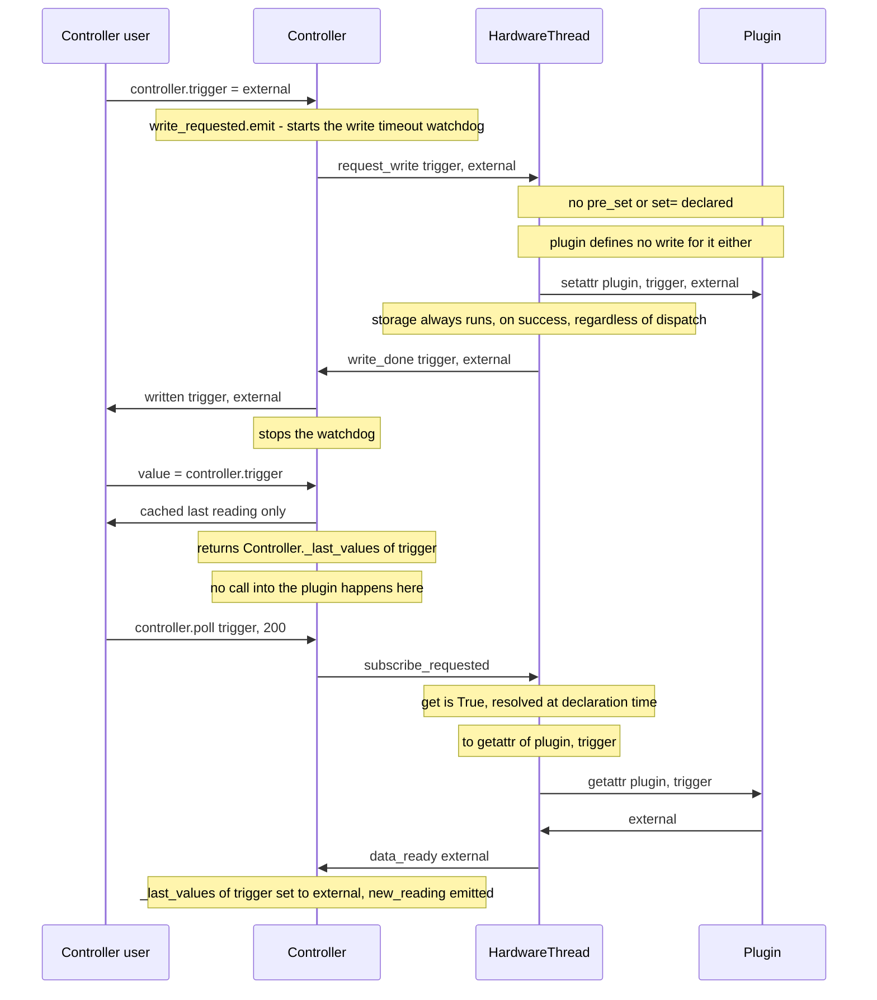

# Capabilities, the device thread and Controller: how this all connects

**Scope of this file:** `capabilities.py`, `subscription.py`, `hardware_thread.py`,
`hardware_registry.py` and `controller.py` - the five modules in this subpackage: declaring a
device's channels, and the thread/controller plumbing that runs them. `HardwareModule`, the
`QMainWindow` built on top of `Controller`, has its own doc -
`control_modules/HARDWARE_MODULE.md` - and is only mentioned here, dashed in the diagram below,
to show where this layer's own API surface gets used next.

## 1. Layers and the thread boundary

One hardware thread per physical device. Everything on the left runs on it; everything on the
right runs on the GUI (or script) thread. The two only ever talk through queued Qt signals - never
a direct call across the line.



| Layer | File | Owns | Created by |
|---|---|---|---|
| Declarations | `capabilities.py` | `Quantity`/`Capabilities`/`Action` - pure data, no Qt | class attributes (`measurement()`/`control()`) |
| Subscription | `subscription.py` | one consumer's request for one channel's readings | `Controller.poll`/`read`/`read_blocking` |
| Hardware thread | `hardware_thread.py` | the plugin instance, its settings tree, every poll timer | `HardwareRegistry._make_thread`, on first `attach` |
| Registry | `hardware_registry.py` | one `(thread, Controller)` entry per `HardwareKey`, reference-counted | `HardwareRegistry.get()` (process-wide), or a test's own instance |
| Controller | `controller.py` | the GUI/script-facing signal wiring and one property per quantity | `HardwareRegistry.attach`, on first attach |

`Controller` is deliberately the *only* object anything outside this subpackage is allowed to talk
to. A script can use it exactly the way a GUI would (`Controller.read_blocking` exists for
precisely that: no window, no event loop of its own needed on the caller's side), and several
callers attaching to the same `HardwareKey` share the same `Controller` instance - so its cached
last values, its polling subscriptions and its write/read timeouts are shared state across all of
them, not duplicated per caller.

## 2. Lifecycle

1. `HardwareRegistry.attach(key, plugin_class, params_state)`. First attach for `key`:
   `controller_class(plugin_class)` builds a `Controller` subclass with one property per declared
   quantity (raises here if a quantity name clashes with an existing `Controller` attribute -
   before anything else exists, so this can never fail later once the thread is running).
   `HardwareThread` is created and moved to a new, started `QThread` - the **plugin itself is not
   created yet**. `Controller.__init__` wires every signal in the table below. A later `attach` for
   the same key just bumps a ref-count and returns the same `Controller`.
2. Something calls `QMetaObject.invokeMethod(thread, 'ini_hardware', Qt.QueuedConnection)` (how
   `HardwareModule` does this). On the hardware thread: the plugin is constructed, `plugin.open(settings)`
   runs, and on success `hardware_status(True, ...)` is emitted, plus `capabilities(instance_caps)`
   if the plugin set its own `self.capabilities` once open (e.g. a shape only known once real
   hardware answers).
3. `detach(key)` drops the ref-count; at zero, `_teardown` closes the controller, calls
   `close_hardware` on the device's own thread (a blocking queued call unless already on that
   thread), then asks the `QThread` to quit and waits for it **unconditionally** - never abandoning
   a thread that might still be running. `HardwareRegistry.get()` also wires `close_all` to the
   application's `aboutToQuit`.

## 3. Signal wiring: `Controller` ↔ `HardwareThread`

Wired once, in `Controller.__init__`:

| Controller → thread (request) | thread → Controller (outcome) |
|---|---|
| `write_requested(name, value)` → `request_write` | `write_done(name, value)` → `written`; `write_failed(name, msg)` → `write_failed` |
| `action_requested(name, action_name, checked)` → `request_action` | `action_done(name, action_name, result)` → `action_done`; `action_failed(name, action_name, msg)` → `action_failed` |
| `subscribe_requested(sub)` → `subscribe` | a poll's reading arrives on `sub.data_ready` directly, not relayed through `Controller`'s own signals |
| `unsubscribe_requested(sub)` → `unsubscribe` | - |
| - | `hardware_status(connected, info)` → `device_status`; `error(msg)` → `device_error`; `capabilities(caps)` → stored for introspection, not re-emitted; `settings_changed(path, data, change)` → applied in place to `self.settings` |

Every one of these crosses the thread boundary as a queued Qt signal/slot call - never a direct
Python call into the plugin from the `Controller` side, and never a direct call into `Controller`
from the hardware thread's own code.

## 4. Reading and writing one channel, worked example

This directly answers a question raised during review: for

```python
trigger = control(values=['internal', 'external'], get=True)
```

what does `controller.trigger = 'external'` actually do, and what does `controller.trigger` read
back?



So: **`<channel>` in the write-storage box above is literally the quantity's own name** - here
`plugin.trigger`, set by `HardwareThread.request_write` every time a write to `trigger` succeeds,
regardless of whether `set=`/a plain `write()` also ran. And **`get=True` is sugar
resolved once, in `Capabilities.__post_init__`, to `lambda plugin: getattr(plugin, 'trigger')`** -
so a `poll`/`read`/periodic batch asks the plugin for `plugin.trigger` directly, which is exactly
the attribute the unconditional storage above just set. That's the whole trick behind "`trigger`
needs nothing else at all": the write side stores for free, the read side is told to answer from
the same place.

One nuance worth being explicit about, since it is easy to assume otherwise: **touching the
`Controller` property only ever returns the *cached* last reading** (`_last_values.get(name)`,
`controller.py`) - it never itself triggers a live `plugin.trigger` call. Only an explicit
`poll`/`read`/`read_blocking`, or a periodic batch already running, ever calls through `get=`. A
freshly-opened device that has never been read/polled answers `None` until one of those runs once.

## 5. Writing a value: every dispatch, side by side

A write's *mechanism* (how the value reaches the device, if anything device-specific happens at
all) is independent from storage (what ends up readable afterwards). Storage is unconditional,
mechanism picks **at most one** of:

| Dispatch | What `request_write` does | Plugin needs |
|---|---|---|
| nothing declared, plugin has no `write()` | nothing beyond storage - the "just an attribute" case | nothing |
| nothing declared, plugin defines `write(name, value)` | `plugin.write(channel, value)` | one `write()` handling every control name it's given |
| `set=callable` | `set(plugin, value)` instead of `write()` | the callable |
| `set='_method_name'` | sugar for `lambda plugin, value: plugin._method_name(value)` | that one-arg method |

Whichever applies (or none), `request_write` then **always** does `setattr(plugin, channel,
value)`. `pre_set=`/`post_set=` hook into that step specifically - they are **mutually exclusive**
with `set=`, not stackable with it:

| Hook | Runs | Can do |
|---|---|---|
| `pre_set=callable` or a method name string | before storage | reject the write (raise → `write_failed`, same as `set()`/`write()` raising; storage is then skipped) |
| `post_set=callable` or a method name string | after storage | a side effect that can rely on `plugin.<name>` already holding the new value |

A string on any of `get=`/`set=`/`pre_set=`/`post_set=` is sugar for calling that plugin method by
name with the natural arguments (`post_set='_clamp_averaging'` instead of writing
`lambda plugin, value: plugin._clamp_averaging(value)`), resolved once in
`Capabilities.__post_init__`, before anything else that reads `quantity.get`/`.set`/etc. sees it -
including the readback default below.

### Wrapping an existing instrument object (pymeasure or otherwise): compose, don't inherit

A question worth answering explicitly, since the "written in the pymeasure style" wording at the
top of `capabilities.py` invites it: if a plugin's actual hardware access goes through a
[pymeasure](https://pymeasure.readthedocs.io/) `Instrument` (or any other SDK object with its own
get/set-by-attribute convention), does declaring the same name with `control()`/`measurement()`
make `plugin.trigger = value` run *that* object's own property logic? **No** - and not just as a
missing feature, but structurally, for a reason worth understanding before reaching for it:

`Quantity` is itself a full data descriptor -
`__get__`/`__set__` (`capabilities.py:291-308`) - and `__set__` does nothing but
`instance.__dict__[self.name] = value`: plain storage, no device access at all. Writing
`trigger = control(...)` in a plugin's class body makes `plugin.trigger` resolve to *this*
descriptor from then on, for every instance of that class. If the plugin also happens to inherit
from a pymeasure `Instrument` subclass that already defines `trigger` as pymeasure's own
command-sending property, the plugin's own declaration **replaces** that name in the MRO - it
doesn't layer PyMoDAQ's metadata on top of pymeasure's descriptor, it shadows it outright, the same
rule `Capabilities.from_device` relies on deliberately for a subclass overriding its *own* parent's
quantities (`capabilities.py:688`). Pymeasure's real `trigger` logic for that attribute name
simply stops being reachable on that class. Separately, and independently of any name collision:
with no `set=`/`write()` declared, `request_write` only ever reaches the unconditional storage step
above - "store it as a plain attribute," never "do whatever some other descriptor would have done
for this name."

The collision is always about **the same attribute name meaning two different things** - it isn't
specific to inheritance, and it isn't specific to pymeasure's own convention either. Which fix
applies depends on whether the wrapped driver's own API already uses distinctly-named methods, or
reuses the quantity's own name the way pymeasure's property-based `control()`/`measurement()` do.

**Different names (a driver with plain `get_x()`/`set_x()` methods): inherit, and reference the
method directly - no bridge code at all.** `get=`/`set=` already accept any
`Callable[[Any], Any]`, called as `getter(plugin)`/`setter(plugin, value)` - so a plain,
undecorated function reference works as-is, with no lambda, no string, the moment the plugin
actually *is* the driver through inheritance:

```python
class MyInstr:
    """The real driver - no PyMoDAQ import anywhere in this class."""
    def get_trigger(self):
        return self.ask('TRIG:SOUR?')

    def set_trigger(self, value):
        self.write(f'TRIG:SOUR {value}')


class MySpectrometer(MyInstr):
    trigger = control(values=['internal', 'external'],
                       get=MyInstr.get_trigger, set=MyInstr.set_trigger)
```

`getter(plugin)` is literally `MyInstr.get_trigger(plugin)`, and since `plugin` *is* a `MyInstr`
through inheritance, every `self.ask(...)`/`self.write(...)` inside it resolves normally. This
works for a genuine pymeasure property too, as long as the PyMoDAQ-facing name is different from
pymeasure's own - reach into the property object's `fget`/`fset` instead of a method:
`get=SomePymeasureInstrument.trigger.fget` for a PyMoDAQ quantity named e.g. `trigger_source`
(accessing a `property` through the *class*, not an instance, returns the property object itself,
standard Python - no PyMoDAQ-specific magic involved).

**Same name, or composed rather than inherited (one plugin holding several instrument instances,
or simply not wanting to tie the plugin's own lifecycle to the driver's): compose, and redirect
`self` with `instr_get`/`instr_set` (`capabilities.py`) - still passing the real method, not a
bridge method per quantity:**

```python
from pymodaq.control_modules.hardware.capabilities import control, instr_get, instr_set

class MySpectrometer:
    controller: MyInstr  # type hint only, for IDE autocompletion on self.controller.<method> -
                          # the same name and the same trick ini_stage/ini_detector already use

    def open(self, settings):
        self.controller = MyInstr(resource_name)  # assigned here, not __init__ - see below

    trigger = control(values=['internal', 'external'],
                       get=instr_get(MyInstr.get_trigger), set=instr_set(MyInstr.set_trigger))
```

`instr_get(method, attr='controller')`/`instr_set(method, attr='controller')` default to
`'controller'` to match that same old-style convention; pass `attr=` to override it for a
differently-named attribute, or for a plugin composing more than one instrument. *`method`* has to
be the driver class's own method, referenced directly as above (`MyInstr.get_trigger`) - **never**
`self.controller.get_trigger`: `control()`/`measurement()` run in the class body, before any
instance (and so `self`) exists at all, so there is nothing for `self` to refer to at that point.
`instr_get`/`instr_set` only resolve `attr` against the real instance later, inside the lambda they
return, when the hardware thread actually calls it - which is always well after `open()` has
already run, so assigning `self.controller` there rather than in `__init__` (same timing as
`ini_stage`/`ini_detector`) is not just safe, it is the expected shape.

`plugin.controller` (the driver's own state) and `plugin.trigger` (PyMoDAQ's unconditional storage,
section 5 above) are two different attributes on two different objects, so there's nothing left to
collide.

A `proxy='_instr'` kwarg on `control()`/`measurement()` itself - generalizing `get=True` from
"answer from `plugin.<name>`" to "answer from `getattr(plugin, proxy).<name>`," so a quantity could
skip naming `get=`/`set=` at all - was considered and rejected: it only pays for itself
when the driver's own attribute name matches the PyMoDAQ quantity name exactly, it would need a
real decision about whether a proxied write still also does the unconditional storage step (two
copies of the value that could drift) and how it interacts with `pre_set=`/`post_set=`'s
exclusivity with `set=`, and `instr_get`/`instr_set` above already get the same ergonomics with no
new `Quantity` field to maintain - consistent with `attr=` and `curves=`, both added and then
removed earlier in this same review once an explicit form proved just as clear with nothing
left to keep in sync.

## 6. Reading one channel

| Form of `get=` | Resolves to | Effect on periodic batching |
|---|---|---|
| nothing (default) | the channel is answered through `plugin.read(names, fresh)`, shared with every other channel at the same poll period | included in the shared batch |
| `get=True` | `lambda plugin: getattr(plugin, name)` | **opts the channel out of batching** - read individually |
| `get='_method_name'` | `lambda plugin: plugin._method_name()` | opts out, same as above |
| `get=callable` | used as-is | opts out, same as above |

A single-channel request (Read/Snap, a one-shot subscription, `read_blocking`) always uses a
channel's own `get` if it has one. A *periodic* read (`HardwareThread._read_period`) batches every
channel sharing a poll period into one `plugin.read(names=[...], fresh=True)` call, but only for
the channels *without* their own `get` - declaring `get=` on one channel is therefore also a
decision to stop sharing hardware transactions with the others at that period, not only a question
of where the value comes from.

`readback=True`/`readback='name'` on a `control()` auto-creates a measurement that answers "what is
the device actually doing." Its own `get` defaults to the control's `get`, if the control has one -
right when the control has no real settling lag, so the control's own answer already is the
readback's answer (exactly `exposure`'s case in the spectrometer example: `get=True` on both ends
up reading the same attribute twice, for free). A control with no `get` of its own - the case with
real lag, e.g. a target vs. a motor's actual position - gets an empty auto-created readback
instead, answered through the plugin's own `read()`.

## 7. Actions and timeouts

- **Actions** (`run_action(channel, action_name, checked)`): any number of named callbacks per
  channel, not only `stop=`. `action_done(channel, action_name, result)` /
  `action_failed(channel, action_name, msg)` mirror the write done/failed shape. `interrupts=True`
  on an `Action` (what `stop=` sets automatically) resolves whatever write timeout is pending on
  that control, the same way a real `write_done` would.
- **Timeouts, both directions:** every write and every single read now has its own timer, owned by
  `Controller` (`WRITE_TIMEOUT_S`/`READ_TIMEOUT_S`, `pymodaq_utils.config`'s `[hardware_module]`
  section - not hardcoded). A write that never gets `write_done`/`write_failed` within the window
  emits `write_failed` itself; a read that never resolves emits the new, per-channel
  `read_failed(channel, message)` - previously a read failure only had a generic, channel-less
  `error`.
- **Settings sync** is two separate, deliberately asymmetric paths so neither loops back into the
  other: a GUI/script edit goes through `update_settings`, applied under a `QSignalBlocker` before
  `commit_settings` runs; the plugin changing its own settings (inside `commit_settings` itself, or
  anywhere else) fires the tree's real `sigTreeStateChanged`, forwarded as `settings_changed` and
  applied to `Controller.settings` with a re-entrancy flag (`_syncing_from_device`) set around the
  call, so that application doesn't get mistaken for a fresh edit and sent back out again.
  Forwards `'value'`, `'limits'`, `'options'` and `'childAdded'`, mirroring the legacy
  `send_param_status`/`ThreadStatus.UPDATE_SETTINGS` pair (`control_modules/plugin_base.py`/
  `utils.py`): the first three cross as plain data, `'childAdded'`'s own data
  (`(child, pos)`, *child* a live `Parameter` of the hardware thread's own tree) is serialized
  first (`child.saveState()`) and rebuilt fresh on the GUI side (`param.insertChild(pos, state)`),
  never reusing the original object across the thread boundary.

## 8. A crash this feature also fixes

A rare, reproducible native segfault (Linux/PySide6; not reproduced on Windows) when one device's
`QThread.start()` happened to coincide with Python's cyclic GC collecting a `QTimer`/
`HardwareThread` left over from an earlier, already-closed, unrelated device - exactly the race
`QObject`'s own cross-thread-deletion warnings describe. Found by instrumenting `gc.callbacks`
alongside a thread-count sampler, not by guessing. Fixed with one `gc.collect()` call in
`HardwareRegistry._make_thread`, right before each new `QThread` starts, so a new thread's startup
can never race a GC pass collecting a leftover from an old one. Verified with a dedicated stress
test (10 runs per previously-crashing configuration, 0/10 after the fix, where the same
configurations had been crashing 60-100% of the time before it).

Two related, smaller issues were fixed alongside it: a `lambda`-based timer reconnection that
created an unnecessary `self → _timers → timer → (connection) → lambda → self` reference cycle
(now broken by disconnecting before `deleteLater()`), and a teardown path that could give up
waiting on a slow-to-stop thread instead of always waiting unconditionally.

## 9. Known gaps

- `WRITE_TIMEOUT_S`/`READ_TIMEOUT_S` are process-wide config defaults, not per-channel - a device
  mixing one fast channel with one genuinely slow one (a multi-second camera exposure, an averaging
  lock-in) shares one timeout window for both.
- Instance capabilities (`self.capabilities`, set after `open()`) reach `Controller` but are only
  stored, never acted on - no live-refresh path for a new quantity appearing, or an existing one's
  `units`/`shape`/values changing after `open()`.
- A control backed directly by a named entry in the plugin's own `params` - and keeping its
  declaration and GUI rendering in sync with that entry, both ways - is a separate, bigger piece,
  deliberately not in this feature at all (no such dispatch is declarable here). Kept on
  `exploration/setting-domain-from-params` as the starting point for a dedicated follow-up PR that
  does the whole thing, including the bidirectional sync, properly.
- Nothing here has run against real hardware yet; `pymodaq_plugins_mock`-backed plugins only.
- This file lives here, next to the code it describes, deliberately - the design is still moving
  through review. Once it settles and merges, the plugin-authoring parts of it (declaring
  quantities, wrapping an existing SDK object) belong in the Sphinx docs too
  (`docs/src/developer_folder/`, alongside `plugins.rst`), where third-party plugin authors would
  actually find them; nothing there covers this yet.

## See also

- `control_modules/HARDWARE_MODULE.md`: `HardwareModule`, the GUI built entirely on top of
  `Controller`'s API above - toolbars, LEDs, settle-watch polling, views.
- `packages/pymodaq/examples/hardware_module_minimal_example.py` and the catalog/spectrometer/stage
  examples alongside it: every dispatch and `get=`/`set=`/`pre_set=`/`post_set=` combination above,
  each isolated in its own row.
